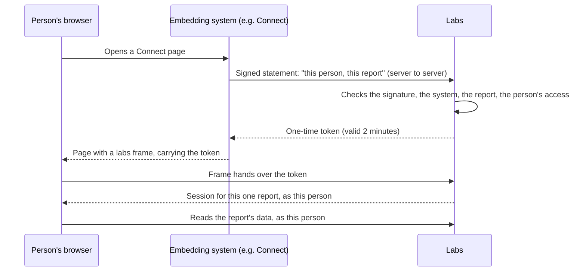

# Embedding Labs in Other Systems

Labs reports can appear **inside another system's pages**, in a frame, with no second sign-in. The first system this is for is CommCare Connect: a Connect page can show a labs workflow, such as a programme's stock review, to whoever is looking at it.

!!! note "Who this is for"
    - **Programme teams** who want a labs report to appear inside Connect: read [What viewers see](#what-viewers-see) and [Getting a report embedded](#getting-a-report-embedded).
    - **Dimagi staff** who register a system that may embed labs: read [Registering an embedding system](#registering-an-embedding-system).
    - **Engineers on the embedding system** (Connect, or another system later): read the [integration guide](#integration-guide).

---

## What Viewers See

An embedded report is the **same report** people see in labs, drawn by the same code, without the labs menus and header around it.

| Question | Answer |
| --- | --- |
| **Whose data** | The person looking at it. Labs shows them exactly what they could see if they opened the report in labs themselves, no more. Two people looking at the same page can see different things. |
| **Which run** | The newest run of the workflow. A page (a workflow with no runs) shows itself. A workflow that has no runs yet says so. |
| **What they can do** | Read only. An embedded report cannot start a run, save changes, or run the workflow's actions (its action buttons are hidden). To change anything, open the report in labs. |
| **Who can be shown it** | Only people the embedding system signs in, and only reports Dimagi staff have registered for that system. |

!!! info "First-time viewers"
    For now, a person must have **signed in to labs at least once** before an embedded report can be shown to them. Someone who never has sees an error inside the frame, and the embedding system is told why. This limit goes away once Connect adds a small, standard piece on its side (see [What's next](#whats-next)).

---

## How It Works

The embedding system and labs never share a password or a secret key. The embedding system proves who it is with a **digital signature**, and labs checks it against the public key the system registered.



1. When someone opens the page, the embedding system's **server** signs a short statement: who the person is and which labs report to show. It sends the statement to labs.
2. Labs checks:
    - that the signature is genuine;
    - that the system is registered and switched on;
    - that the report is one this system may show;
    - that the person can open it.

    It then answers with a **one-time token** that expires in two minutes.

3. The page shows a labs **frame** and hands it the token. Labs exchanges the token for a session for **that one report**, for **that person**, inside that frame only.
4. Every read the report makes goes to Connect **as that person**, so Connect's own permissions decide what comes back.

---

## Security Model

Embedding is designed so that framing labs never weakens labs.

- **Nothing is embeddable until registered.** Dimagi staff register each embedding system, the exact websites (origins) allowed to frame labs, and the exact reports each may show. Every other labs page still refuses to be framed.
- **No shared secrets.** Labs holds only the embedding system's *public* keys. Anyone who reads labs' copy still cannot sign as that system.
- **The person's own permissions.** An embedded report runs as the person it was opened for, with their own Connect sign-in. Labs also checks, before issuing a token, that the person may open the report.
- **One report, read-only.** The embed session reaches only the reads of the one report it was issued for. It cannot reach any other report, any labs page, the admin, the MCP, or anything that writes. It is never a labs login.
- **Tied to the embedding page.** The session's cookie is *partitioned*: the browser keeps it only for the embedding website. Another website that frames labs has no session to use.
- **Fresh every time.** A token works once, for two minutes. Each frame load needs a new one. A frame never shows one person's view to someone else who opens the page later on the same computer.
- **Recorded.** Issuing a token, starting a session, every refusal, and every read the report makes are written to the labs audit trail, attributed to the person.
- **Can be switched off.** Turning a system off in admin ends its sessions on their next request. Dimagi engineers can also turn all embedding off at once.

---

## Getting a Report Embedded

Ask in **#engineering-connect** with:

1. The **report**: its labs address (for example `https://labs.connect.dimagi.com/labs/workflow/123/run/?opportunity_id=456`). The workflow number and its opportunity or programme come from that address.
2. **Where it should appear**: which system and which page.
3. **Who should see it.** Labs will show each person only what they can already see, so check that the intended viewers have access to the opportunity or programme in Connect.

Dimagi staff then add the report to that system's registration (below), and the embedding system's engineers place the frame on their page.

---

## Registering an Embedding System

*Dimagi staff only. Registering a system, and changing what it may show, needs a labs **superuser**.*

Go to **Django admin → Embedding labs in other systems → Embed clients → Add**.

| Field | What to enter |
| --- | --- |
| **Client id** | A short name with no spaces, such as `connect`. The embedding system puts this in its signed statements. |
| **Name** | A readable name, such as "CommCare Connect (production)". |
| **Active** | Ticked. Unticking ends every session this system issued, on its next request. |
| **Identity authority** | Ticked **only for a system labs already trusts to say who people are**. Today that is Connect, because labs accounts come from Connect sign-in. A system without it cannot get tokens yet (see [What's next](#whats-next)). |
| **JWKS URI** *or* **JWKS** | Where the system publishes its public keys (an `https://` address), **or** the keys themselves pasted in as `{"keys": [ ... ]}`. Fill exactly one. Public keys only: labs refuses a key with private parts. |
| **Allowed origins** | The websites allowed to frame labs, as a list of exact origins: `["https://connect.dimagi.com"]`. There is no path and no wildcard. |
| **Resources** | The reports it may show (see below). |
| **Session seconds** | How long a frame's session lasts once opened. Default 3600 (one hour). The minimum is 60 and the maximum is 28800 (eight hours). |

**Resources** is a list. Each entry names a **kind** of thing, its **id**, and the scope it lives in:

```json
[
  {"kind": "workflow", "id": 123, "opportunity_id": 456},
  {"kind": "workflow", "id": 789, "program_id": 25}
]
```

- `kind`: what is embedded. Today the only kind is `workflow`, which also covers pages (a page is a workflow).
- `id`: the workflow's number.
- Exactly one of `opportunity_id` or `program_id`: where the workflow lives. Use what its labs address names.

Labs checks every field when you save and tells you what is wrong.

### Ending sessions

**Django admin → Embed sessions** lists every embed session: who, which report, and when it was issued, started, drawn and expires. Select sessions and choose **End these embed sessions now** to end them immediately.

### Switching all embedding off

Setting the environment variable `LABS_EMBED_ENABLED=false` on the labs deployment switches off every embed endpoint and session at once. It is an emergency switch; the normal way to stop one system is to untick **Active**.

---

## Integration Guide

*For engineers on the embedding system. Everything here is standard: RFC 7523 (a JWT as an authorization grant), JWKS public keys, and an iframe.*

Labs: `https://labs.connect.dimagi.com`

### 1. Make a key pair and register it

Use an Ed25519 key (recommended), an ES256 (P-256) key, or an RSA key of at least 2048 bits signing RS256. Keep the private key on your server. Send labs the public key as a JWKS, or publish it at an `https://` address.

```python
# pip install "pyjwt[crypto]"
import json
from cryptography.hazmat.primitives.asymmetric import ed25519
from cryptography.hazmat.primitives import serialization
from jwt.algorithms import OKPAlgorithm

key = ed25519.Ed25519PrivateKey.generate()
pem = key.private_bytes(
    serialization.Encoding.PEM, serialization.PrivateFormat.PKCS8, serialization.NoEncryption()
)
public_jwk = OKPAlgorithm.to_jwk(key.public_key(), as_dict=True)
public_jwk["kid"] = "connect-2026-10"  # any name; put it in each JWT header
print(json.dumps({"keys": [public_jwk]}))  # send this (public) to labs
```

Give labs your JWKS (or its URL), your **client id**, the **origins** that will frame labs, and the **reports** to show. To rotate a key, publish the new key alongside the old, switch to signing with it, then remove the old one. A published JWKS is re-read within an hour, or sooner when a `kid` labs has not seen arrives.

### 2. Sign a statement for each page load

The statement is a JWT. Make a new one every time you render a page with a labs frame.

| Claim | Value |
| --- | --- |
| `iss` | Your client id. |
| `sub` | The person's **Connect username** (the account labs knows them by). |
| `aud` | `https://labs.connect.dimagi.com/embed/token/` |
| `iat` | Now, in seconds since the epoch. |
| `exp` | At most 300 seconds after `iat`. 60 is plenty. |
| `jti` | A new random id. Each statement works once. |
| `resource` | The frame address: `https://labs.connect.dimagi.com/embed/c/<client id>/<kind>/<id>/` |

Put your key's `kid` in the JWT header when you have more than one key.

### 3. Exchange it for a token, server to server

```
POST https://labs.connect.dimagi.com/embed/token/
Content-Type: application/x-www-form-urlencoded

grant_type=urn:ietf:params:oauth:grant-type:jwt-bearer&assertion=<the JWT>
```

A success:

```json
{
  "access_token": "<one-time token>",
  "token_type": "Bearer",
  "expires_in": 120,
  "embed_url": "https://labs.connect.dimagi.com/embed/c/connect/workflow/123/"
}
```

The whole step in Python:

```python
import time, uuid, jwt, requests

LABS = "https://labs.connect.dimagi.com"

def labs_embed(username: str, kind: str, resource_id: int) -> dict:
    now = int(time.time())
    resource = f"{LABS}/embed/c/connect/{kind}/{resource_id}/"
    assertion = jwt.encode(
        {"iss": "connect", "sub": username, "aud": f"{LABS}/embed/token/",
         "iat": now, "exp": now + 60, "jti": str(uuid.uuid4()), "resource": resource},
        PRIVATE_KEY, algorithm="EdDSA", headers={"kid": "connect-2026-10"},
    )
    response = requests.post(f"{LABS}/embed/token/", timeout=10, data={
        "grant_type": "urn:ietf:params:oauth:grant-type:jwt-bearer",
        "assertion": assertion,
    })
    response.raise_for_status()
    return response.json()  # embed_url, access_token
```

Never send the token request from the browser: the private key must stay on your server.

### 4. Put the frame on the page

Hand the token to the frame in the address's **fragment** (after `#`). Browsers never send the fragment to a server, so it stays out of logs.

```html
<iframe src="{{ embed_url }}#token={{ access_token }}"
        title="Stock review"
        style="width: 100%; min-height: 800px; border: 0"></iframe>
```

Or load the frame without a token and post it in once the frame asks:

```javascript
const LABS = "https://labs.connect.dimagi.com";
const frame = document.getElementById("labs-frame");

window.addEventListener("message", async (event) => {
  if (event.origin !== LABS || event.source !== frame.contentWindow) return;
  const msg = event.data || {};
  if (msg.type !== "labs-embed") return;
  if (msg.event === "needs-token") {
    const { access_token } = await fetch("/my-server/labs-token?report=123").then((r) => r.json());
    frame.contentWindow.postMessage({ type: "labs-embed-token", token: access_token }, LABS);
  }
});
```

Always name labs' origin when posting, and check `event.origin` when listening.

**Your page's own security policy** must allow the frame: include `https://labs.connect.dimagi.com` in your `frame-src` (or `child-src`) if you set a Content-Security-Policy.

### 5. Messages the frame sends

The frame posts these to its parent, addressed only to your registered origins:

| Message | When | What to do |
| --- | --- | --- |
| `{type: "labs-embed", event: "needs-token", kind, id}` | The frame loaded with no usable session: without a token, or reloaded. | Mint a new token on your server and post it in as `{type: "labs-embed-token", token}`. |
| `{type: "labs-embed", event: "ready", kind, id}` | The report is drawn. | Nothing; useful for hiding a spinner. |
| `{type: "labs-embed", event: "error", error, kind, id}` | The token could not start a session (used, expired, for another report). | Mint a new token, or show your own message. |

A token posted in at any time **replaces** the frame's session, so when the person signed in to your system changes, post in a token for the new person.

### 6. Errors from the token endpoint

Errors follow OAuth (RFC 6749): a JSON body `{"error": ..., "error_description": ...}`. The description is safe to show to a person.

| `error` | Usually means |
| --- | --- |
| `invalid_request` | The `assertion` parameter is missing. |
| `unsupported_grant_type` | `grant_type` is not `urn:ietf:params:oauth:grant-type:jwt-bearer`. |
| `invalid_client` (401) | Unknown or inactive client id, or the signature does not check out: wrong key, unknown `kid`, or an algorithm labs does not accept (HMAC and `none` never are). |
| `invalid_grant` | Wrong `aud`, expired, valid for more than five minutes, `jti` missing or already used, no labs account for `sub`, the person has never signed in to labs, or **the person cannot open this report**. |
| `unauthorized_client` | This client is not allowed to say who people are (not an identity authority). |
| `invalid_target` | `resource` is not a labs embed address, or names a report this client is not registered for. |

---

## Troubleshooting

| Symptom | Check |
| --- | --- |
| The frame is blank and the browser console says framing "violates the following Content Security Policy directive: frame-ancestors" | The page's origin is not in the system's **Allowed origins**. Origins must match exactly, including `https://` and any port. |
| The frame says *"This view is shown inside another system."* | The frame address was opened on its own, not inside a frame. Tokens are only taken inside a frame. |
| The frame shows *"This embed token has already been used"* or *"has expired"* | A token is single-use and lasts two minutes. Mint one per page load, just before rendering the page, and do not cache it. |
| `invalid_grant`: *"That person has not signed in to labs yet."* | Ask them to sign in to labs once at [labs.connect.dimagi.com](https://labs.connect.dimagi.com). |
| `invalid_grant`: *"This person cannot open that workflow."* | They do not have access to the report's opportunity or programme. Check their Connect access, or check that the resource entry names the right scope. |
| The report draws but says an opportunity "is not accessible to your account" | The person can open the report but not everything it reads. That is their real access, applied as it would be in labs. |
| Reloading only the frame shows a loading message | Expected: each load needs a new token. Answer the frame's `needs-token` message (step 5). |
| A report left open for a long time stops loading new data | Its session lasts the system's **Session seconds** (an hour by default), and the person's Connect sign-in must still be valid. Post in a new token, or reload the page. |

---

## What's Next

- **Viewers who have never opened labs.** Connect will accept a standard request from labs: "Connect has just told me this is the person; give me their access". After that, a first-time viewer needs no labs sign-in at all.
- **Systems other than Connect.** A system that does not decide who people are will be able to embed labs for people who have linked their labs account to it once (and can unlink it). Separately, a system will be able to show labs reports built on generated, non-personal data to its own users.
- **More kinds of things.** Embedding is built around kinds of resource, so other labs views (supply pages, microplans, Pulse boards) can be added one at a time without changing how embedding works.

Engineers: the full design, including why it is built this way and how other products (Tableau, Power BI, Superset) do the same, is in the repository at `docs/superpowers/specs/2026-10-23-embedding-labs-design.md`.
