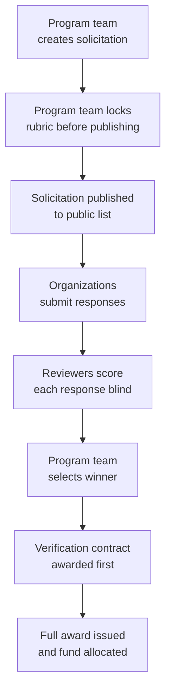

# Solicitations

The Solicitations module manages requests for proposals (RFPs) and expressions of interest (EOIs). An organisation posts a call for partners, other organisations respond, and the organisation that posted it reviews and scores the responses and makes an award. Any organisation can run its own calls, the same way any organisation can run a programme in Supply.

---

## Where Solicitations Live, and Who Sees What

Every call belongs to an **organisation** — the one that posted it. That organisation's members manage the call and are the only people (apart from Dimagi platform support) who can read the responses to it.

| Page | Address | Who can open it |
| ---- | ------- | --------------- |
| **All open calls** | `/solicitations/` | Anyone, signed in or not. Every listed call that is still open, each naming the organisation that posted it, with a **Recently closed** section underneath, then **Past calls**. Search by keyword, or filter by organisation, by type (EOI or RFP) and by program. |
| **A past call** | `/solicitations/past/<name>/` | Anyone. One of the calls Dimagi ran on the Connect marketplace before calls were posted here (see **Past calls** below). |
| **A call** | `/solicitations/<number>/` | Anyone, for a listed call. Shows who posted it, the deadline, what it asks and how responses are scored. Long calls have a key-facts strip and an **On this page** index. |
| **An organisation's calls** | `/solicitations/o/<organisation>/` | Anyone. The organisation's open calls and its past ones (Dimagi's page also lists the past marketplace calls). The marketplace page for an organisation links here when it has listed calls. |
| **Manage calls** | `/solicitations/o/<organisation>/manage/` | Members of that organisation, and platform support. Every call the organisation owns, including drafts and unlisted calls, with how many responses each has, and a **New call** button. |
| **Responses, scoring and award** | from the Manage page | Members of the owning organisation, and platform support. Never someone scoring or awarding a response from their own organisation — except on a demonstration award (see below). |
| **Your response** | linked from the call | The person who submitted it. |

**Solicitations** is in the left-hand menu for everyone. **Manage calls** (`/solicitations/manage/`) lists the organisations you can manage calls for; if there is only one, it takes you straight there. If there are none, it explains how to get access: you are a member of an organisation either through CommCare Connect (when the organisation is registered in labs) or because someone who manages it in labs added you. Seeing an organisation's programme in the context selector does not make you a member of it.

A call that is **not listed** does not appear in the directory or on the organisation's page; only the organisation that owns it, platform support, and people who already responded to it can open it. A **draft** is visible only to the organisation that owns it. A response that is not yours looks exactly like one that does not exist ("not found").

**The demo organisation.** `solicitations_seed_demo` makes an invented organisation, "Kestrel Community Health (demo)", with three open calls for showing the module to others. Its calls are **not listed**, so nobody finds and answers them by accident, but anyone you send a link to can open them, at the call's own address or the demo organisation's page (`/solicitations/o/<demo organisation>/`). Every one carries a **Demo call — invented organisation** banner.

**Past calls.** The calls for partners Dimagi ran on the Connect marketplace (the expressions of interest and requests for proposal recorded in the LLO Directory) are listed under **Past calls** at the bottom of `/solicitations/`, grouped by the year they ran, and on Dimagi's organisation page. Dimagi owns every one of these past rounds — CHC, KMC, Readers, malaria, RUTF, chlorine, and any new round added to the LLO Directory's EOI/RFP tab. Each card shows the program it was for, with the program's picture, the countries it covered and when it was published. The existing keyword search and the organisation and type filters all cover past calls, and there is a dedicated **program** filter for them. A past call's page shows its type, program, countries, and its published, deadline and decision dates, along with a **Read the announcement** button that opens the original public announcement. They are an archive: nobody can respond to, edit, review or award one here, and nothing about who applied is shown. If you are signed in you also see how many organisations applied, and a link to the call's page on the marketplace (which lists the applicants, behind the labs login). The marketplace's page for a finished call links back here with **Public call page** — that is the link to send to someone outside labs.

**Who belongs to the Dimagi organisation.** Anyone with a `@dimagi.com`, `@dimagi-ai.com`, or `@dimagi-associate.com` address is automatically a member of the Dimagi organisation in Solicitations. This means Dimagi associates can manage Dimagi's calls and, because Dimagi owns all past EOI/RFP rounds, can access responses to those rounds through the same Manage calls page that any organisation member uses. Being a member of the Dimagi organisation in Solicitations does not grant access to admin pages, Settings, or any other staff-only area — those remain unchanged.

**Status shown on every call:**

| Status | Meaning |
| ------ | ------- |
| **Open** | Taking responses: published, and the deadline (if there is one) has not passed. A call stays open until the end of its deadline day. |
| **Closed — deadline passed** | Published, but the deadline has passed. No new responses can be submitted, and drafts can no longer be sent. |
| **Closed** | Closed by the organisation that posted it. |
| **Awarded** | A response has been awarded. |
| **Draft** | Not published yet. |

---

## Process Overview

---

## For Program Managers (Creating & Managing)

### Creating a Solicitation

Click **Solicitations** in the left-hand menu, then **Manage your calls**, pick your organisation, and click **New call**. The form asks which organisation the call is **from**: you can choose any organisation you are a member of. Only that organisation's members (and platform support) will see the responses.

Fill in:

| Field               | Description                                                                          |
| ------------------- | ------------------------------------------------------------------------------------ |
| Title               | Name of the solicitation (e.g., "Expression of Interest: OCS Implementation – Niger 2026") |
| Type                | Expression of Interest or Request for Proposals                                      |
| Description         | Full context: program background and what you're looking for                         |
| Scope of Work       | What the implementing organization must do                                           |
| Budget              | Maximum funding available                                                            |
| Deadline            | When responses are due                                                               |
| Evaluation criteria | What you'll score responses on                                                       |
| Response template   | Questions responding organizations must answer                                       |
| Status              | Draft (not yet public) or Published                                                  |

After you save a new solicitation, Labs takes you directly to that solicitation's responses page so you can monitor for incoming submissions right away.

**Programme tag:**
Every solicitation now carries a programme tag drawn from Connect's standard programme names (for example, Kangaroo Mother Care, Child Health Campaign, Readers Distribution, Malaria). This tag appears on the marketplace home page, the solicitation page, and the organization page. When creating a solicitation, select the programme it belongs to so organizations can find it through the programme filters and so it is clearly distinguished from other rounds — for example, "CHC 2024 — Northern Nigeria" and "CHC 2025 — East & Southern Africa" appear as separate, clearly labelled rounds rather than both showing as "CHC".

**AI-assisted criteria generation:**
Click **Generate Criteria** and paste in text describing your program requirements, or upload a PDF. The AI will suggest a structured set of evaluation criteria and scoring weights. Review and adjust the suggestions before saving.

**Adding context to response questions:**
When building your response template, each question has an optional **Framing** field where you can write one or two sentences explaining why you're asking that question. This framing appears above the question prompt on the public solicitation page, displayed in muted italic text, so respondents understand the intent behind the question — not just what you're asking. Framing is optional; questions without it display exactly as before.

The question input box in the template editor automatically expands to fit longer question text, so lengthy questions are always fully visible as you type.

The published solicitation shows the number of questions in the response template. This count is phrased correctly for any number — for example, "1 question" or "3 questions".

!!! info "Validation errors on the creation form"
Labs now checks that all fields are in the correct format when a solicitation is saved. If something is wrong — for example, a deadline that isn't a valid date, an evaluation criterion missing a name, or a response question that references something that no longer exists — you will see an inline error message on the relevant field. Correct the flagged fields and save again. These checks prevent incomplete or misformatted solicitations from being stored silently.

### Locking the Rubric Before Publishing

For survey-firm procurements and any solicitation where a defensible, consistent scoring process matters, Labs lets you lock the evaluation rubric before the call goes public.

**How it works:**

1. Build and review your evaluation criteria — either manually or using **Generate Criteria**
2. Click **Lock Rubric** once you are satisfied with the criteria and their weights
3. Publish the solicitation

Once locked, the criteria and their weights are fixed for the entire period the call is open. No reviewer or program manager can modify them while the solicitation is published. This ensures every applicant is scored against exactly the same standard.

A **Rubric locked before publishing** badge is displayed on the solicitation page and on the responses list, so reviewers and program managers can see at a glance that the scoring framework was set before any applications came in.

!!! warning "Locking is permanent while the solicitation is open"
You cannot unlock or edit the rubric after locking without first returning the solicitation to Draft status. If you need to revise the criteria, set the solicitation back to Draft, make your changes, lock again, and republish. Do not republish until you are confident the criteria are final — applicants who submitted under the previous criteria will have answered questions calibrated to the original rubric.

### Creating a Solicitation from a Micro-Plan

If your solicitation is tied to specific geographic areas already defined in Labs, you can start directly from a micro-plan or plan group rather than writing the solicitation from scratch.

**From a plan group:**
Go to the plan group's management page and click **Create solicitation**. The solicitation form opens pre-filled with a title and scope of work drawn from the region, and with all plans in the group already attached as coverage areas. The pre-filled title does not repeat the place name — if the group and region share a name, it appears only once.

**From a single plan:**
Go to the plan's review page and click **Create solicitation**. The form opens pre-filled in the same way, with that one plan attached as a coverage area.

In both cases, the coverage areas are shown on a map on the creation form, with the actual ward boundaries drawn for each attached plan. You can edit any pre-filled field before publishing. Once you save the solicitation, Labs takes you directly to that solicitation's responses page. The attached plans become a fixed snapshot — later edits to the underlying micro-plans will not change what is shown on the published solicitation.

The coverage areas are displayed on the public solicitation page — both as a map showing the ward boundaries and as a list — so applicants can see exactly which areas are on the table. The ward count is shown at a readable size alongside the map.

!!! info "Plans are captured as a snapshot"
Because coverage areas are fixed at the time the solicitation is created, any changes you make to a micro-plan after that point will not be reflected in the solicitation. If your plans change significantly before the deadline, you will need to update the solicitation's coverage areas manually or create a new solicitation.

### Choosing Where the Work Happens

A call that is not started from a micro-plan has a **Where the work happens** section on its form, with two choices:

- **Anywhere** (the default): respondents say where they would work, anywhere.
- **Only inside areas I choose**: pick one or more areas on the map, such as a state or a few districts. Respondents can then pick only areas inside them.

To choose an area, pick the country, then click the area on the map, or search for it by name in the map's panel. Clicking picks the smallest area under your pointer (usually a ward). To take the larger area around it, use **Select parent** in the panel's **Inspect** tab.

The call's page shows these areas on a map, as a dashed outline, so applicants know where the work is before they start.

A call started from a micro-plan offers its plans instead, as described above. A call offers one or the other, never both.

### Saying Where You Would Work

When you respond to a call that is not tied to a micro-plan, the response form has a **Where would you do this work?** map. Pick the areas you would work in, at whatever level fits your organisation: a whole state, a district, or a handful of wards. Each area you pick appears below the map with its level (for example "Kano · State" or "Gwale · Ward"), and you can remove it with ×.

- If the call is limited to certain areas, the map shows them as a dashed outline and you can pick only areas inside them. You must pick at least one area to submit, though a draft can be saved without one.
- If the call is open to anywhere, choose the country first. Picking areas is optional.

If you pick a state and also a ward inside that state, only the state is kept, because it already covers the ward.

The call's owner sees the areas you picked on the responses list, on the scoring page, on a map in your response, and on the award page.

### Reading the Coverage Map Legend

Wherever a coverage map appears — on the solicitation page, the response submission form, and the responses review pages — a small legend is displayed on the map showing how areas are colour-coded:

| Colour | Meaning       |
| ------ | ------------- |
| Green  | Intervention area |
| Blue   | Comparison area   |

This applies to all coverage maps across the solicitations module.

### Reviewing Responses

Once the deadline passes, open your organisation's **Manage calls** page and click the response count next to the call (or click **Responses** on the call's own page, which only you and your colleagues see).

The page header shows the solicitation's current state. Once a winner has been awarded, the header updates to show **Awarded** so you can see at a glance that the process is complete.

The responses table pins the **Organization** column to the left edge, so firm names remain visible even when you scroll the table horizontally to see all columns.

For each response:

1. Click **Score** on its row. The scoring page shows the answers and selected coverage areas, but not who sent them
2. Read the answers to each question
3. Review the applicant's selected coverage areas — these are shown on the responses list and on the scoring page
4. Score the submission
5. Score each criterion from 1–10 and add notes — every criterion in the rubric has a score field, including criteria that are not tied to a specific application question (such as Independence or Timeline)
6. Set your recommendation: Approve / Reject / Needs Revision

Multiple reviewers can score independently. Each reviewer has one review per response: scoring the same response again updates your earlier review rather than adding a second one. You cannot score or award a response submitted by your own organisation.

Once a review is saved, the full criterion-by-criterion breakdown is shown on the saved review: each criterion's name, its weight, and the score given out of 10. This replaces the previous single overall number, giving you and other reviewers a clear record of how each dimension was scored.

The responses list shows a **Status** column and a **Recommendation** column for each submission. For an awarded response, **Awarded** appears only in the Status column — the Recommendation column shows your reviewer recommendation as normal, without repeating "Awarded". Where a response has not yet been scored, the Score cell shows a neutral dash (—); the Recommendation column shows the **Pending review** indicator for that submission.

The **Actions** column (containing the Award control) is pinned to the right edge of the responses table. This means it stays visible and reachable even when the table is wide, without needing to scroll horizontally. The Score cell is no longer clipped by the pinned Actions column.

#### Blind Scoring

Scoring is always blind. The responses list shows each submission only as **Response #[number]**, and its **Score
