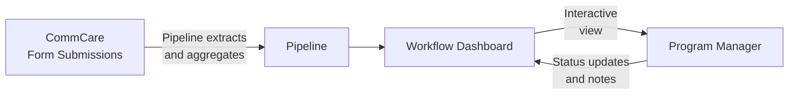

# Workflow Engine

The Workflow Engine lets program managers view configurable dashboards that pull live data directly from CommCare. Each workflow displays field worker performance metrics and supports drill-down into individual records, status tracking, and filtering.

---

## How Data Flows

**Pipelines** define what data to pull from CommCare and how to aggregate it — counts, sums, most recent values, percentages, and more. **Workflows** define what to display and how users interact with it.

---

## Finding Your Workflows

Click **Workflows** in the top navigation. You'll see a list of all workflows configured for your program.

Each row shows:

- Workflow name and type
- Last run time and data freshness
- Current status
- A schedule badge (for example, **⏱ Weekly**) if the workflow is running on an automatic schedule

Click any workflow to open its dashboard.

On the Workflows list, **pages** (see [Pages](#pages)) appear alongside regular workflows but show an **Open page** button instead of **Start run**. Pages do not appear in the workflow run list.

### Navigating on a phone

On a phone, the purple menu rail that normally runs down the left side of the screen is hidden to give your workflow content the full width of the screen. A **menu button** (☰) in the top-left corner of the header opens the same navigation as a drawer that slides over the page. To close the drawer, tap anywhere outside it, press its close button, or press **Escape**. On a tablet, laptop, or desktop, the layout is unchanged.

### The PERIOD column

The **PERIOD** column in the workflow list shows the date window that was actually audited for each run. Once a run has fired and audited data, this reflects the real window that was processed — which may differ from the date range that was set when the run was first created (for example, when you used the generic **Create Run** button).

When the audited window differs from the original creation-time range, the column shows an **ⓘ info icon** next to the date. Hovering over or tapping the icon shows the original creation-time range for reference. If the two windows are the same, no icon appears.

This means the PERIOD column is the authoritative record of what was actually covered by a run, not just what was intended when it was set up.

### Data freshness on scheduled reports

Scheduled reports can display when their data was actually last synced — and every reader sees the same figure regardless of which device they are on or when they last refreshed their browser.

Previously, the only freshness signal a report could show came from the reader's own browser, so it described when *that browser* last pulled data rather than when the underlying data was refreshed. On a report like the Ward Progress Tracker, this meant a reader on a second device — or one who simply had not refreshed in a while — might see "18h 36m ago" even though the data had in fact been refreshed at 04:21 that morning.

Scheduled reports that display a "last synced" or "last refreshed" time now draw that figure from the schedule itself, so it reflects the real sync time and is consistent across all readers.

### Run failure reasons

If a scheduled or unattended run fails, the run now records the reason for the failure alongside the failed status. Previously, a failure was logged with no error message, making it impossible to diagnose the problem without accessing production logs. You can now see what went wrong directly on the run record, which makes it easier to decide whether to retry, adjust settings, or contact support.

### Deep-linking to a specific workflow card

If someone shares a direct link to a specific workflow card — for example, a URL ending in `#workflow-5110` — the page will smoothly scroll to that card and briefly highlight it so you can spot it immediately, even on a long list. This works the same way in both the program view and the opportunity view.

### Program-level vs. opportunity-level workflows

Workflows in Connect Labs are owned by either a **program** or a specific **opportunity**:

- **Program-owned workflows** are scoped directly to the program — they have no owning opportunity at all. They appear in the program view only, cover the program as a whole — for example, the Program Audit Creator and Program Audit Report — and do not appear under any individual opportunity. All operations on these workflows (opening them, creating a run, viewing a run page) work entirely within the program context; no opportunity is needed. When you open a program-owned workflow, it verifies your access at the program level and loads its pipeline data across all the opportunities the workflow spans — you do not need to select an individual opportunity first.
- **Opportunity-owned workflows** appear under their specific opportunity only. They will not appear in the program-level workflow list.

This means each workflow appears in exactly one place. If you cannot find a workflow you expect to see, check whether you are viewing the program level or the relevant opportunity level.

!!! note "The opp: badge is not shown in the program view"
    When you are browsing the program-level workflow list, opportunity identifiers are not displayed next to workflow names. Only workflows that are explicitly owned by the program appear there, so the badge carries no useful information at that level and is hidden to keep the list uncluttered.

!!! note "Creating a run from the program view"
    Clicking **Create Run** on a program-owned workflow works the same as creating a run from any other context. Because these workflows are genuinely scoped to the program rather than to any opportunity, Create Run resolves correctly from the program view with no extra steps required.

    If you have recently opened a per-opportunity run in another tab (for example, by clicking an "open run ↗" link"), that should no longer affect Create Run on program-owned workflows. The program view keeps the program context in place, so Create Run on a program-owned workflow will always create the run under the program — not under whichever opportunity you last visited. If you do see a "Workflow not found" error, try refreshing the program workflow list page and clicking Create Run again.

!!! note "Drilling into worker visits from a program-level report"
    When you open a worker's case in the worker review from a programme report created at program level, their visits now load correctly. Previously, this could show a "pipeline not found" error; this has been fixed and visit data loads as expected.

### Protected (sandboxed) workflows

Some workflows are designed to run inside a **protected frame** — sometimes called a sandbox. Pages and workflows on Labs are drawn directly in the page by default. To preview the sandboxed version of any page or workflow, add `?sandbox=1` to its address in your browser (or `&sandbox=1` if the address already contains a `?`).

A workflow in the protected frame looks and works exactly the same as normal, but it operates with an important safety constraint: its content cannot act on your behalf without asking you first.

Specifically, a protected workflow cannot:

- Create tasks or audits
- Start a coaching conversation with a worker
- Start a background job that creates records
- Complete or delete a run
- Attach or detach one of its own pipelines
- Mark runs it is watching in a control room

…without Labs first showing you a prompt along the lines of **"This workflow wants to …, as you."** The prompt appears in an amber box with **Cancel** focused, so dismissing it is the default action. Confirming once covers that type of action for the next two minutes, so you will not be asked repeatedly during a single session.

On each workflow's listing you will see a line indicating whether it is built to support the protected frame. If it is, a **View it sandboxed** link lets you try the protected version by opening it with `?sandbox=1`.

If you are asked to confirm an action you did not expect while previewing in sandbox mode, that is the protection working as intended — check what the workflow is about to do before clicking yes.

#### Scrolling and layout in the sandbox

When you open a workflow or page in the sandbox, it looks and scrolls exactly like the normal (non-sandboxed) version:

- The page grows to match the length of its content — there is no second scrollbar inside the report.
- The page scrolls as a whole, so the browser's own scrollbar is the only one you use.
- Dialogs open where you are looking, toasts appear at the bottom of the window, and tooltips appear beneath whatever you hover.
- **Jump to** buttons and fields that receive focus scroll the page to bring themselves into view.

One deliberate difference from the normal page: a header row set to stay fixed at the top of the report sticks just below the Labs header, where it remains visible as you scroll. On the normal page, that same sticky header can slide underneath the Labs header and become hidden.

!!! note "All live workflows are fully compatible with the sandbox"
    Every workflow that exists on Labs today works correctly in the protected frame. This includes the older MBW monitoring dashboards, which load their data, stream their progress, open GPS details, and save snapshots as normal. Authorization buttons (such as **Authorize CommCare** or **Authorize OCS**) bring you back to the workflow after you sign in. Any confirmation question a workflow presents is shown in Labs' own dialog and properly waited for before continuing. No workflow requires an exemption from the sandbox.

#### Sandbox exemptions

~~A small number of older workflow copies contain code that relies on features the sandbox will never support~~ All live workflows are now fully compatible with the sandbox, so no exemptions are needed or granted. The exemption mechanism is no longer in use.

If you previously saw a workflow listed as exempt, that status no longer applies.

#### Reading another workflow's runs in the protected frame

A protected workflow can read the saved runs of another workflow only if its settings explicitly declare that relationship — for example, the way a worker review names the program report it belongs to, or the way a page lists the workflows it displays.

If a protected workflow tries to read runs from a workflow it has not declared, it will show the message **"This workflow or page does not declare that workflow"** rather than loading any data.

For most reports this makes no visible difference. One case where it does matter: the MBW auditing reports, when running in the protected frame, will no longer carry categories and notes across from a *different* workflow's runs unless that other workflow is listed in the report's settings. Categories and notes from a report's own runs continue to carry over as before.

If you notice a report no longer showing categories or notes that you expect from another workflow, the report's settings may need to be updated to declare that workflow. Contact your program administrator or support if you are unsure.

### Indicator definition popup

In KMC reports (program, opportunity, and worker review) and the generic indicator reports, you can click an indicator's name to open a popup with its full definition. The popup has been restyled to make it easier to read:

- The indicator's **title** appears at the top, with its ID shown once as a small tag beneath it — it is no longer repeated twice.
- The **title and close button** stay fixed at the top of the popup, and the **sort and download links** stay fixed at the bottom, so these controls are always visible while the definition text scrolls between them.
- **Out of / Counts / Shown** appears in a clean box with dividers. Each term has its own entry with its meaning shown on the line below, rather than everything running together.
- **Thresholds** are displayed as small chips rather than inline text.
- The **underlying query** sits below a divider and wraps onto multiple lines, so long queries are no longer cut off at the right edge of the popup.

---

## Pages

A **page** is a screen built with the same workflow tools as a regular workflow, but it has no runs. Instead of collecting data over a date range and producing a run to review, a page simply displays what an organisation, program, or opportunity holds — with links into each — and can show the latest run of any workflow you are able to open.

Pages are useful for landing screens and summary views that you want to keep permanently visible without starting a new run each time.

### How pages are different from workflows

| | Regular workflow | Page |
|---|---|---|
| Has runs | Yes | No |
| Workflows list button | **Start run** | **Open page** |
| Built with workflow tools | Yes | Yes |
| Can show pipeline data and worker details | Yes | Yes |
| Can open visit photos and draw maps | Yes | Yes |
| Can create tasks or audits (with confirmation) | Yes | Yes |
| Can start AI coaching conversations (with confirmation) | Yes | Yes |
| Can save run state or complete a run | Yes | No |

Pages can now be built with the full set of workflow tools. They can show pipeline data and worker details, open visit photos, draw maps with admin boundaries and map tiles, and create tasks or audits — with Labs asking for confirmation first, the same way a protected workflow does. The only things a page cannot do are those that require a run: saving run state, completing a run, running a declared action, or running a background job.

### Actions on a page

A page can have buttons that trigger actions — the same types of actions a report can trigger — scoped to the organisation, program, or opportunity the page belongs to:

- **Create follow-up tasks** for workers
- **Start an AI coaching conversation** with workers

When you click one of these buttons, Labs opens its confirmation dialog showing you exactly which workers are affected and what will be sent. Nothing happens until you confirm. This is the same "nothing happens until you confirm" protection that applies to protected workflows.

!!! note "Coaching from a page vs. coaching from a report"
    When coaching is triggered from a page, the message sent is the one the page itself declares. Briefings, pictures, and case conversations — which are drawn from a report's saved figures — are only available from reports, not from pages.

### Access to workflows shown on a page

A page can display the latest run of other workflows. You will only see a workflow's run on a page if you have access to open that workflow directly — the same check that applies when you open it from the Workflows list. This applies to all workflows, including synthetic (labs-only) ones.

### Managing pages for a scope

An organisation, program, or opportunity can have **several pages**. The **Pages list** at `/labs/p/<org|programme|opportunity>/<key>/pages/` shows every page belonging to that scope — for an organisation, this includes its own pages and those of its programs. For each page you can see where it lives and which one is currently set as the home page.

Anyone who can use the scope can view the Pages list.

#### Creating a new page

If you can change Settings for the scope, a **New page** button appears on the Pages list. Clicking it asks for a title and an address, then opens the new page in the editor. You can also mark it as the home page at the same time.

#### Choosing the home page

Anyone who can change Settings for the scope can click **Make home** next to any page on the Pages list to set that page as the home. You can also choose the home page from **Settings → Labs**, which now shows a list of the scope's pages to pick from rather than requiring you to type a workflow id. The JSON editor is still available under **Advanced: edit as JSON** for cases where you need it.

When you are editing a page, **Pages** and **Make this the home page** links appear next to the Settings link so you can manage the scope's pages without leaving the editor. If a scope has no home page set, those links point to the Pages list so you can set one.

### Editing a page

The **Edit page** link appears for anyone who can change Settings for the organisation, program, or opportunity that owns the page. If you can view a page but do not have Settings access for its scope, the link is not shown — and Labs will refuse any attempt to save edits even if you navigate directly to the editor's address.

### Addresses for pages

Each level of Labs has its own address for its page:

| Level | Address |
|---|---|
| Organisation | `/labs/p/org/<organisation>/` |
| Program | `/labs/p/programme/<id>/` |
| Opportunity | `/labs/p/opportunity/<id>/` |

!!! note "Old page links"
    The previous page addresses at `/labs/p/<name>/` no longer exist. If you follow an old link, Labs will take you to the new page at the correct address when your organisation, program, or opportunity has one. If no matching page is found, you will see a message explaining that pages have moved rather than an error. Update any bookmarks or shared links to use the new addresses shown in the table above.

### Context picker on a page

When you open a page, the context picker in the header identifies what you are looking at:

- An **organisation's page** shows **Org: \<name\>** in the header.
- A **program's page** shows the program name.
- An **opportunity's page** shows the opportunity name.

This replaces the yellow **Select Context** button that previously appeared when no context had been chosen. You no longer need to select a context manually — opening the page sets it automatically.

### Setting an organisation's home page

An organisation can have one page designated as its **home page**. When someone picks that organisation in Labs — or follows a link to `/labs/overview/?organization_id=<organisation>` — they land on the home page instead of the default overview.

To set the home page, go to the organisation's **Settings** and choose the page you want visitors to land on from the list of the organisation's pages. You must have access to the program or opportunity behind the page in order to set it as
