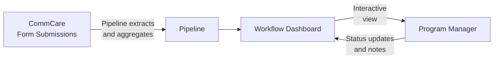

# Workflow Engine

The Workflow Engine lets program managers view configurable dashboards that pull live data directly from CommCare. Each workflow displays field worker performance metrics and supports drill-down into individual records, status tracking, and filtering.

---

## How Data Flows

**Pipelines** define what data to pull from CommCare and how to aggregate it — counts, sums, most recent values, percentages, and more. **Workflows** define what to display and how users interact with it.

---

## Finding Your Workflows

Click **Workflows** in the top navigation. You'll see a list of all workflows configured for your program.

Each row shows:

- Workflow name and type
- Last run time and data freshness
- Current status
- A schedule badge (for example, **⏱ Weekly**) if the workflow is running on an automatic schedule

Click any workflow to open its dashboard.

On the Workflows list, **pages** (see [Pages](#pages)) appear alongside regular workflows but show an **Open page** button instead of **Start run**. Pages do not appear in the workflow run list.

### Navigating on a phone

On a phone, the purple menu rail that normally runs down the left side of the screen is hidden to give your workflow content the full width of the screen. A **menu button** (☰) in the top-left corner of the header opens the same navigation as a drawer that slides over the page. To close the drawer, tap anywhere outside it, press its close button, or press **Escape**. On a tablet, laptop, or desktop, the layout is unchanged.

### The PERIOD column

The **PERIOD** column in the workflow list shows the date window that was actually audited for each run. Once a run has fired and audited data, this reflects the real window that was processed — which may differ from the date range that was set when the run was first created (for example, when you used the generic **Create Run** button).

When the audited window differs from the original creation-time range, the column shows an **ⓘ info icon** next to the date. Hovering over or tapping the icon shows the original creation-time range for reference. If the two windows are the same, no icon appears.

This means the PERIOD column is the authoritative record of what was actually covered by a run, not just what was intended when it was set up.

### Data freshness on scheduled reports

Scheduled reports can display when their data was actually last synced — and every reader sees the same figure regardless of which device they are on or when they last refreshed their browser.

Previously, the only freshness signal a report could show came from the reader's own browser, so it described when *that browser* last pulled data rather than when the underlying data was refreshed. On a report like the Ward Progress Tracker, this meant a reader on a second device — or one who simply had not refreshed in a while — might see "18h 36m ago" even though the data had in fact been refreshed at 04:21 that morning.

Scheduled reports that display a "last synced" or "last refreshed" time now draw that figure from the schedule itself, so it reflects the real sync time and is consistent across all readers.

### Run failure reasons

If a scheduled or unattended run fails, the run now records the reason for the failure alongside the failed status. Previously, a failure was logged with no error message, making it impossible to diagnose the problem without accessing production logs. You can now see what went wrong directly on the run record, which makes it easier to decide whether to retry, adjust settings, or contact support.

### Deep-linking to a specific workflow card

If someone shares a direct link to a specific workflow card — for example, a URL ending in `#workflow-5110` — the page will smoothly scroll to that card and briefly highlight it so you can spot it immediately, even on a long list. This works the same way in both the program view and the opportunity view.

### Program-level vs. opportunity-level workflows

Workflows in Connect Labs are owned by either a **program** or a specific **opportunity**:

- **Program-owned workflows** are scoped directly to the program — they have no owning opportunity at all. They appear in the program view only, cover the program as a whole — for example, the Program Audit Creator and Program Audit Report — and do not appear under any individual opportunity. All operations on these workflows (opening them, creating a run, viewing a run page) work entirely within the program context; no opportunity is needed. When you open a program-owned workflow, it verifies your access at the program level and loads its pipeline data across all the opportunities the workflow spans — you do not need to select an individual opportunity first.
- **Opportunity-owned workflows** appear under their specific opportunity only. They will not appear in the program-level workflow list.

This means each workflow appears in exactly one place. If you cannot find a workflow you expect to see, check whether you are viewing the program level or the relevant opportunity level.

!!! note "The opp: badge is not shown in the program view"
    When you are browsing the program-level workflow list, opportunity identifiers are not displayed next to workflow names. Only workflows that are explicitly owned by the program appear there, so the badge carries no useful information at that level and is hidden to keep the list uncluttered.

!!! note "Creating a run from the program view"
    Clicking **Create Run** on a program-owned workflow works the same as creating a run from any other context. Because these workflows are genuinely scoped to the program rather than to any opportunity, Create Run resolves correctly from the program view with no extra steps required.

    If you have recently opened a per-opportunity run in another tab (for example, by clicking an "open run ↗" link"), that should no longer affect Create Run on program-owned workflows. The program view keeps the program context in place, so Create Run on a program-owned workflow will always create the run under the program — not under whichever opportunity you last visited. If you do see a "Workflow not found" error, try refreshing the program workflow list page and clicking Create Run again.

!!! note "Drilling into worker visits from a program-level report"
    When you open a worker's case in the worker review from a programme report created at program level, their visits now load correctly. Previously, this could show a "pipeline not found" error; this has been fixed and visit data loads as expected.

---

## Pages

A **page** is a screen built with the same workflow tools as a regular workflow, but it has no runs. Instead of collecting data over a date range and producing a run to review, a page simply displays what an organisation, program, or opportunity holds — with links into each — and can show the latest run of any workflow you are able to open.

Pages are useful for landing screens and summary views that you want to keep permanently visible without starting a new run each time.

### How pages are different from workflows

| | Regular workflow | Page |
|---|---|---|
| Has runs | Yes | No |
| Workflows list button | **Start run** | **Open page** |
| Built with workflow tools | Yes | Yes |

### Access to workflows shown on a page

A page can display the latest run of other workflows. You will only see a workflow's run on a page if you have access to open that workflow directly — the same check that applies when you open it from the Workflows list. This applies to all workflows, including synthetic (labs-only) ones.

### Managing pages for a scope

An organisation, program, or opportunity can have **several pages**. The **Pages list** at `/labs/p/<org|programme|opportunity>/<key>/pages/` shows every page belonging to that scope — for an organisation, this includes its own pages and those of its programs. For each page you can see where it lives and which one is currently set as the home page.

Anyone who can use the scope can view the Pages list.

#### Creating a new page

If you can change Settings for the scope, a **New page** button appears on the Pages list. Clicking it asks for a title and an address, then opens the new page in the editor. You can also mark it as the home page at the same time.

#### Choosing the home page

Anyone who can change Settings for the scope can click **Make home** next to any page on the Pages list to set that page as the home. You can also choose the home page from **Settings → Labs**, which now shows a list of the scope's pages to pick from rather than requiring you to type a workflow id. The JSON editor is still available under **Advanced: edit as JSON** for cases where you need it.

When you are editing a page, **Pages** and **Make this the home page** links appear next to the Settings link so you can manage the scope's pages without leaving the editor. If a scope has no home page set, those links point to the Pages list so you can set one.

### Editing a page

The **Edit page** link appears for anyone who can change Settings for the organisation, program, or opportunity that owns the page. If you can view a page but do not have Settings access for its scope, the link is not shown — and Labs will refuse any attempt to save edits even if you navigate directly to the editor's address.

### Addresses for pages

Each level of Labs has its own address for its page:

| Level | Address |
|---|---|
| Organisation | `/labs/p/org/<organisation>/` |
| Program | `/labs/p/programme/<id>/` |
| Opportunity | `/labs/p/opportunity/<id>/` |

!!! note "Old page links"
    The previous page addresses at `/labs/p/<name>/` no longer exist. If you follow an old link, Labs will take you to the new page at the correct address when your organisation, program, or opportunity has one. If no matching page is found, you will see a message explaining that pages have moved rather than an error. Update any bookmarks or shared links to use the new addresses shown in the table above.

### Context picker on a page

When you open a page, the context picker in the header identifies what you are looking at:

- An **organisation's page** shows **Org: \<name\>** in the header.
- A **program's page** shows the program name.
- An **opportunity's page** shows the opportunity name.

This replaces the yellow **Select Context** button that previously appeared when no context had been chosen. You no longer need to select a context manually — opening the page sets it automatically.

### Setting an organisation's home page

An organisation can have one page designated as its **home page**. When someone picks that organisation in Labs — or follows a link to `/labs/overview/?organization_id=<organisation>` — they land on the home page instead of the default overview.

To set the home page, go to the organisation's **Settings** and choose the page you want visitors to land on from the list of the organisation's pages. You must have access to the program or opportunity behind the page in order to set it as the home page, and visitors will only be taken to the home page if they have that same access.

!!! note "Only pages can be set as the home page"
    Settings will only accept a page as the home page — you cannot set a regular workflow (one with runs) as the home. If you try to select a regular workflow, Settings will refuse it. If an address that was previously saved as a home is not a page, opening it will show a "this home is not a page" message rather than drawing anything. Pages created from the "Page" starter before pages were formally labelled as pages still count as pages and continue to work as homes.

### Pages in the Supply tab

A page can also be set to fill a **Supply tab**. When configured this way, the page opens inside the Supply header without starting a run. This lets you show stock summaries, links to supply workflows, or other supply-related content directly from the Supply tab.

The Supply tab opens only for people who have access to the program or opportunity it is linked to. Setting up a Supply tab also requires access to that program or opportunity. A program can hide or rename a Supply tab that its organisation added — use the **Hide** button in Settings to do this.

### Building a page

Pages are built with the standard workflow tools. To create one, start from the **Page** template in the workflow builder, or use the **New page** button on the Pages list. Once published, the page appears in the Workflows list with an **Open page** button in place of **Start run**.

!!! note "Pages cannot be started as runs"
    A page cannot be started as a run — this applies to pages created from the blank page template as well as any other page template. If you need to collect data over a date range and review it, use a regular workflow instead.

### How pages handle runs and links

A few behaviours are worth knowing when you share or follow page links:

- **Run numbers in a page's address are ignored.** If a page address includes a run number (for example, because someone copied it from a workflow run), the page simply opens as normal — pages have no runs, so the number has no effect.
- **A workflow's run page only shows runs for that workflow.** Runs from other workflows are never mixed in.
- **Relative links inside a page open where they point.** Previously these could be refused; they now work as expected.
- **Pages draw correctly under all allowed addresses.** If Labs is opened under an alternative allowed address (for example, a local development address), pages render properly rather than showing a blank frame.

---

## Settings

Settings uses the word **program** (not "programme") throughout.

### Who can change Settings

Who can change Settings and edit pages depends on whether the organisation, program, or opportunity is a **labs-only (synthetic)** scope or a **real partner** scope:

- **Labs-only (synthetic) scopes** — anyone signed in with a **@dimagi.com** or **@dimagi-ai.com** email address can change Settings and edit pages, including scopes that have no administrator. This means a Dimagi person can always manage a synthetic scope, even if nobody else administers it.
- **Real partner scopes** — Settings and page editing are controlled by the scope's own members (as Connect defines them) and any individuals who have been explicitly granted labs staff access. A Dimagi email address alone does not grant access to a real partner organisation, program, or opportunity.

If you believe you should have access to a real partner scope's Settings but do not, ask the scope's administrator to grant you access directly.

### Synthetic organisations

A synthetic organisation groups every synthetic program that shares the same organisation name, regardless of who created them. Members of a synthetic organisation can read its Settings, but only **Dimagi staff** can make changes to a synthetic organisation's Settings. Each individual synthetic program can still set its own Settings independently.

!!! note "Settings forms"
    If you enter a value that is not a valid number in a Settings form, you will see a clear error message rather than a crash. Correct the value and save again.

---

## The RUTF Supply Demo

The RUTF supply demo is a synthetic clone program used for exploring and testing the Supply features in Labs. When the demo is seeded (or reseeded), it sets itself up to look realistic on whatever day seeding runs.

### What the Stock review shows

On the Stock review, most workers hold roughly 3½ to 5 weeks of RUTF at their own 14-day dispensing pace. About one in six workers falls below their minimum stock level, so the headline figure — **N of M workers below minimum at their own 14-day pace** — the alerts, and the blockers all have real data to display. Before this was corrected, workers appeared to hold 21 to 109 days of stock and nobody was ever below minimum, which made those indicators meaningless.

Invented deliveries continue to arrive every fortnight in the days after seeding, recorded each day they fall due rather than being batched once a week, so the figures stay believable as time passes.

### What reseeding sets up

Reseeding the demo now also builds everything the demo is viewed through:

- The **Stock review** tab in Supply, following the deployed template (so a template deploy updates it automatically).
- The **Forecast** tab in Supply, also following the deployed template.
- A **program home page** at `/labs/p/programme/<id>/`. The page shows:
    - Workers below minimum
    - When the network runs dry at protocol
    - What share of the protocol children are actually receiving RUTF
    - What stock workers currently hold
    - The stores — displayed in **sachets** (the same unit used across all other Supply screens), with each store's **workers' cover** filled in
    - Open checks
    - Links to every Supply tab and the workflows behind them
    - The canopy agent panel

- If the organisation that owns the demo has no home page yet, reseeding also creates one that links through to the program's page.

---

## Coaching Workers from a Run Page

When you ask the canopy agent to coach a field worker from a Labs run page, the agent can show a **coaching card** directly in the chat. The card displays:

- The worker's name
- The topics the coach will raise
- The first message the worker will receive
- A picture of the worker's figures

### Case coaching — talking to a worker about one baby

In addition to coaching on indicator scores, the agent can now coach a field worker about a **specific baby**. Labs reviews each baby's recent visits and identifies one of four stories that best describes their situation. Every figure in the coaching comes from that baby's own visits.

#### The four stories

| Story | What it means |
|---|---|
| **Danger sign recorded — not referred** | A danger sign was recorded for the baby but the baby was not referred for follow-up care |
| **
