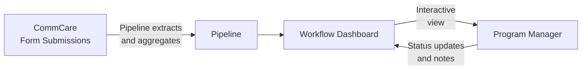

# Workflow Engine

The Workflow Engine lets program managers view configurable dashboards that pull live data directly from CommCare. Each workflow displays field worker performance metrics and supports drill-down into individual records, status tracking, and filtering.

---

## How Data Flows

**Pipelines** define what data to pull from CommCare and how to aggregate it — counts, sums, most recent values, percentages, and more. **Workflows** define what to display and how users interact with it.

---

## Finding Your Workflows

Click **Workflows** in the top navigation. You'll see a list of all workflows configured for your program.

Each row shows:

- Workflow name and type
- Last run time and data freshness
- Current status
- A schedule badge (for example, **⏱ Weekly**) if the workflow is running on an automatic schedule

Click any workflow to open its dashboard.

On the Workflows list, **pages** (see [Pages](#pages)) appear alongside regular workflows but show an **Open page** button instead of **Start run**. Pages do not appear in the workflow run list.

### Navigating on a phone

On a phone, the purple menu rail that normally runs down the left side of the screen is hidden to give your workflow content the full width of the screen. A **menu button** (☰) in the top-left corner of the header opens the same navigation as a drawer that slides over the page. To close the drawer, tap anywhere outside it, press its close button, or press **Escape**. On a tablet, laptop, or desktop, the layout is unchanged.

### The PERIOD column

The **PERIOD** column in the workflow list shows the date window that was actually audited for each run. Once a run has fired and audited data, this reflects the real window that was processed — which may differ from the date range that was set when the run was first created (for example, when you used the generic **Create Run** button).

When the audited window differs from the original creation-time range, the column shows an **ⓘ info icon** next to the date. Hovering over or tapping the icon shows the original creation-time range for reference. If the two windows are the same, no icon appears.

This means the PERIOD column is the authoritative record of what was actually covered by a run, not just what was intended when it was set up.

### Data freshness on scheduled reports

Scheduled reports can display when their data was actually last synced — and every reader sees the same figure regardless of which device they are on or when they last refreshed their browser.

Previously, the only freshness signal a report could show came from the reader's own browser, so it described when *that browser* last pulled data rather than when the underlying data was refreshed. On a report like the Ward Progress Tracker, this meant a reader on a second device — or one who simply had not refreshed in a while — might see "18h 36m ago" even though the data had in fact been refreshed at 04:21 that morning.

Scheduled reports that display a "last synced" or "last refreshed" time now draw that figure from the schedule itself, so it reflects the real sync time and is consistent across all readers.

### Run failure reasons

If a scheduled or unattended run fails, the run now records the reason for the failure alongside the failed status. Previously, a failure was logged with no error message, making it impossible to diagnose the problem without accessing production logs. You can now see what went wrong directly on the run record, which makes it easier to decide whether to retry, adjust settings, or contact support.

### Deep-linking to a specific workflow card

If someone shares a direct link to a specific workflow card — for example, a URL ending in `#workflow-5110` — the page will smoothly scroll to that card and briefly highlight it so you can spot it immediately, even on a long list. This works the same way in both the program view and the opportunity view.

### Program-level vs. opportunity-level workflows

Workflows in Connect Labs are owned by either a **program** or a specific **opportunity**:

- **Program-owned workflows** are scoped directly to the program — they have no owning opportunity at all. They appear in the program view only, cover the program as a whole — for example, the Program Audit Creator and Program Audit Report — and do not appear under any individual opportunity. All operations on these workflows (opening them, creating a run, viewing a run page) work entirely within the program context; no opportunity is needed. When you open a program-owned workflow, it verifies your access at the program level and loads its pipeline data across all the opportunities the workflow spans — you do not need to select an individual opportunity first.
- **Opportunity-owned workflows** appear under their specific opportunity only. They will not appear in the program-level workflow list.

This means each workflow appears in exactly one place. If you cannot find a workflow you expect to see, check whether you are viewing the program level or the relevant opportunity level.

!!! note "The opp: badge is not shown in the program view"
    When you are browsing the program-level workflow list, opportunity identifiers are not displayed next to workflow names. Only workflows that are explicitly owned by the program appear there, so the badge carries no useful information at that level and is hidden to keep the list uncluttered.

!!! note "Creating a run from the program view"
    Clicking **Create Run** on a program-owned workflow works the same as creating a run from any other context. Because these workflows are genuinely scoped to the program rather than to any opportunity, Create Run resolves correctly from the program view with no extra steps required.

    If you have recently opened a per-opportunity run in another tab (for example, by clicking an "open run ↗" link"), that should no longer affect Create Run on program-owned workflows. The program view keeps the program context in place, so Create Run on a program-owned workflow will always create the run under the program — not under whichever opportunity you last visited. If you do see a "Workflow not found" error, try refreshing the program workflow list page and clicking Create Run again.

!!! note "Opening a program report link after visiting another opportunity"
    If you follow a direct link to a program report — or click a worker drill-through link inside a program report — the report now opens correctly even if your session was last looking at a different opportunity. Previously, this could show a "Workflow definition … not found under opportunity …" error. The link now detects that the workflow belongs to the program and loads it under the program context automatically, with no manual steps required.

!!! note "Drilling into worker visits from a program-level report"
    When you open a worker's case in the worker review from a programme report created at program level, their visits now load correctly. Previously, this could show a "pipeline not found" error; this has been fixed and visit data loads as expected.

### Embedded workflows

Certain workflows and pages can be shown inside another system's interface — for example, inside Connect — without the person needing to sign in to Labs separately. The embedded view displays exactly the same report the person would see if they opened Labs directly, but without the Labs menus or navigation chrome.

What you see is determined entirely by your own account — the embedding system cannot show you data you would not normally be able to access.

!!! note "Read-only"
    Embedded views are read-only. You cannot start a run, save changes, or trigger any action from within an embedded view. To perform those actions, open the workflow directly in Labs.

!!! note "Sign-in requirement"
    You must have signed in to Labs at least once before an embedded view will load for you. If you see a sign-in prompt inside an embedded view, open Labs in your browser, sign in, and then return to the embedding system.

!!! note "For administrators"
    Embedding is not enabled by default for any workflow. A Dimagi superuser must register the embedding system and explicitly list the workflows or pages it is permitted to show, before any embedded view will work. If a workflow you expect to see embedded is not appearing, contact Dimagi support.

### Protected (sandboxed) workflows

Every page and workflow in Labs now runs inside a **protected frame** (sandbox) by default. A workflow's own content cannot act on your behalf without Labs asking you first.

When a workflow wants to do something beyond displaying its own data — such as creating tasks or audits, starting a coaching conversation with a worker, or launching a background job that creates records — Labs shows you a prompt in its own words before anything happens. The prompt appears in an amber box with **Cancel** focused, so dismissing it is the default action. Confirming once covers that type of action for the next two minutes, so you will not be asked repeatedly during a single session.

Pages and workflows should otherwise look and behave exactly as they did before.

!!! note "Details shown in confirmation prompts"
    - **Coaching conversations:** The prompt names the bot, identifies the worker who will receive the message, and quotes the opening message. A workflow can only start a conversation with the task's own worker — it cannot message a different worker on your behalf.
    - **Background jobs:** The prompt names the job before it runs.
    - **Rate limiting:** If a page keeps asking repeatedly, Labs slows it down. After you say no, Labs will not ask again for a few seconds, and it will ask at most 20 times per minute regardless.

Previously, you could preview the sandboxed version of any page or workflow by adding `?sandbox=1` to its address in your browser. That preview option still works, but the sandbox is now active everywhere — you do not need the parameter to get the protected behaviour.

Specifically, the sandbox means a workflow cannot do any of the following without Labs first prompting you:

- Create tasks or audits
- Start a coaching conversation with a worker
- Start a background job that creates records
- Complete or delete a run
- Attach or detach one of its own pipelines
- Mark runs it is watching in a control room

On each workflow's listing you will see a line indicating whether it is built to support the protected frame. If it is, a **View it sandboxed** link lets you try the protected version by opening it with `?sandbox=1`.

If you are asked to confirm an action you did not expect, that is the protection working as intended — check what the workflow is about to do before clicking yes.

#### Scrolling and layout in the sandbox

When you open a workflow or page in the sandbox, it looks and scrolls exactly like the normal (non-sandboxed) version:

- The page grows to match the length of its content — there is no second scrollbar inside the report.
- The page scrolls as a whole, so the browser's own scrollbar is the only one you use.
- Dialogs open where you are looking, toasts appear at the bottom of the window, and tooltips appear beneath whatever you hover.
- **Jump to** buttons and fields that receive focus scroll the page to bring themselves into view.

One deliberate difference from the normal page: a header row set to stay fixed at the top of the report sticks just below the Labs header, where it remains visible as you scroll. On the normal page, that same sticky header can slide underneath the Labs header and become hidden.

#### Dialogs in the sandbox

When you open a dialog inside a sandboxed workflow or page — such as a detail panel, an image viewer, a confirmation box, or any other modal — it now covers the entire window, including the Labs header and side menu, exactly as it does on a regular run page:

- The dimmed background extends over the Labs header and navigation, so they are no longer left bright behind an open dialog.
- The dialog is centred in the full window and can use its full height, so a tall dialog opened near the top of a page will no longer have its title and close button cut off above the report area.

Closing the dialog returns the page to its normal state. Nothing changes when no dialog is open.

#### Saved filters in the sandbox

Dashboards that remember your filter choices — for example, the Ward Progress Tracker's ward and period filters, the KMC audit dashboard's filters, or a status filter that is kept across a CommCare sign-in — continue to remember those choices after a page reload when the sandbox is switched on. The behaviour matches what you already experience without the sandbox.

!!! note "All live workflows are fully compatible with the sandbox"
    Every workflow that exists on Labs today works correctly in the protected frame. Authorization buttons (such as **Authorize CommCare** or **Authorize OCS**) bring you back to the workflow after you sign in. Any confirmation question a workflow presents is shown in Labs' own dialog and properly waited for before continuing. No workflow requires an exemption from the sandbox.

#### Sandbox exemptions

~~A small number of older workflow copies contain code that relies on features the sandbox will never support~~ All live workflows are now fully compatible with the sandbox, so no exemptions are needed or granted. The exemption mechanism is no longer in use.

If you previously saw a workflow listed as exempt, that status no longer applies.

#### Reading another workflow's runs in the protected frame

A protected workflow can read the saved runs of another workflow only if its settings explicitly declare that relationship — for example, the way a worker review names the program report it belongs to, or the way a page lists the workflows it displays.

If a protected workflow tries to read runs from a workflow it has not declared, it will show the message **"This workflow or page does not declare that workflow"** rather than loading any data.

For most reports this makes no visible difference. One case where it does matter: the MBW auditing reports, when running in the protected frame, will no longer carry categories and notes across from a *different* workflow's runs unless that other workflow is listed in the report's settings. Categories and notes from a report's own runs continue to carry over as before.

If you notice a report no longer showing categories or notes that you expect from another workflow, the report's settings may need to be updated to declare that workflow. Contact your program administrator or support if you are unsure.

#### The assistant panel on a run page

Each workflow run page has an assistant panel that can answer questions about the data shown on that page and suggest edits to the workflow or its pipelines. The assistant's access is limited to the run and workflow that the page is currently displaying:

- Asked about a **different run**, the assistant will decline and direct you to the Data page to find that run.
- Any **edits it proposes** can only affect the workflow shown on that page and its associated pipelines — it cannot modify other workflows.

This scope applies to the assistant built into the run page panel. If you use the Labs assistant with your own personal token, that access is unchanged.

### UAT Comparison tab

The **UAT Comparison** tab lets you compare data between your UAT and production environments side by side. Both environments have real verification data — if the verification block on this tab reads zero, that almost certainly means the page did not finish loading rather than that data is missing. Try refreshing the page; if the figure remains zero, contact support.

The dashboard now loads only production data. The separate test/pilot domain and the toggle to switch between them have been removed, as production has carried real verification data for some time and the test domain is no longer in use. This roughly halves the number of data pipelines the dashboard streams on each load, making it faster and more reliable.

Visit history on this tab is limited to the **last 90 days** (a rolling window). The "how does this compare to before the pilot" comparison will show a shorter history for any field worker whose pre-pilot data is older than 90 days — the tab notes this when it applies.

### Verification Summary tab

The **Verification Summary** tab shows an overview of visit verification statuses for the current run.

#### Visits Over Time chart

The **Visits Over Time** chart displays a weekly bar chart of visits broken down by outcome — **Passed**, **Pending Audit**, and **Failed** — stacked with Passed at the bottom. Each bar represents one calendar week, so you can see at a glance whether pass rates are trending up, down, or holding steady over the reporting period, rather than only seeing the current snapshot totals.

### GPS Map tab

The **GPS Map** tab on the MBW Visit Verification dashboard plots every registration point and visit point on an interactive map. Each point now displays a faint shaded ring around it, sized to the GPS accuracy that the device reported at the moment it captured that reading. A larger ring means the phone was less certain of its exact position when it recorded that location.

Hovering over any point shows its accuracy in meters alongside the existing details — worker name, visit date, and verification outcome.

!!! note "Accuracy rings are informational only"
    The size of the ring has no effect on whether a visit passed or failed verification, and does not change any totals or filters elsewhere on the dashboard. It is purely a visual aid to help you judge how precise a given GPS reading was at the time it was taken.

### Indicator definition popup

In KMC reports (program, opportunity, and worker review) and the generic indicator reports, you can click an indicator's name to open a popup with its full definition. The popup has been restyled to make it easier to read:

- The indicator's **title** appears at the top, with its ID shown once as a small tag beneath it — it is no longer repeated twice.
- The **title and close button** stay fixed at the top of the popup, and the **sort and download links** stay fixed at the bottom, so these controls are always visible while the definition text scrolls between them.
- **Out of / Counts / Shown** appears in a clean

### Visit data completeness

Reports and audits that display visit history draw on a stored copy of each program's visit data to keep load times fast. In rare cases, two things loading that data at exactly the same moment —
